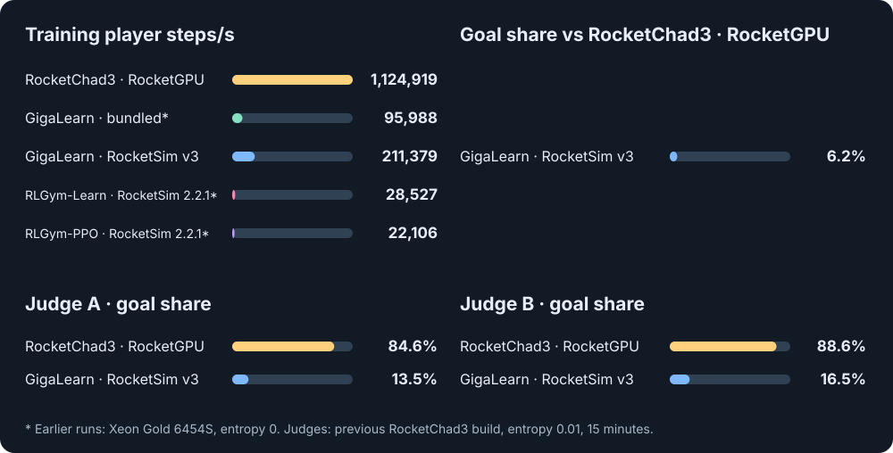
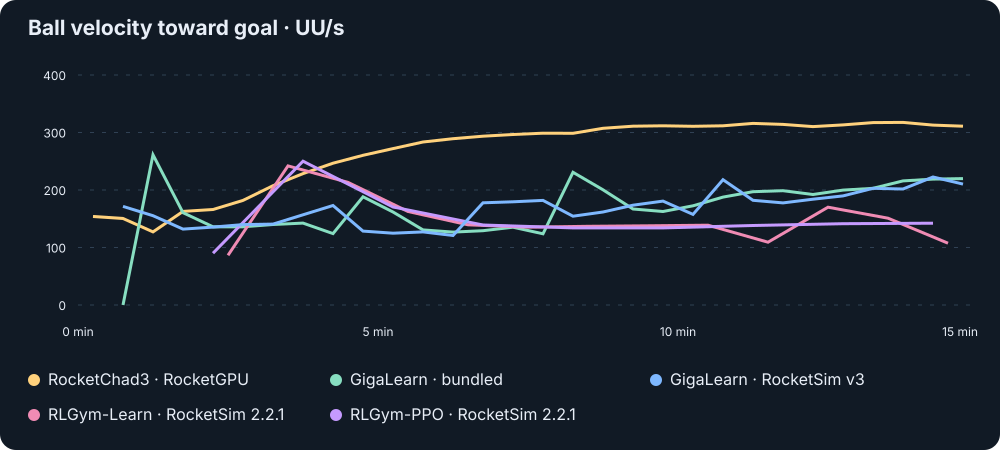
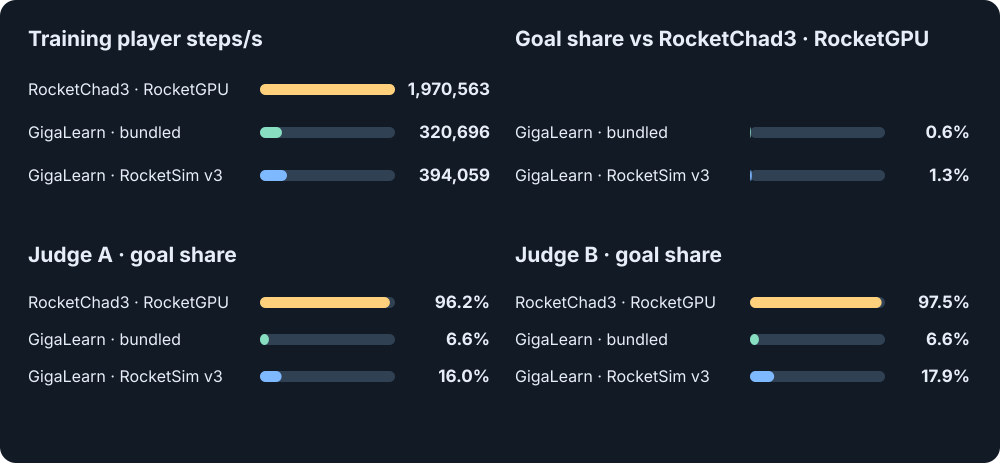
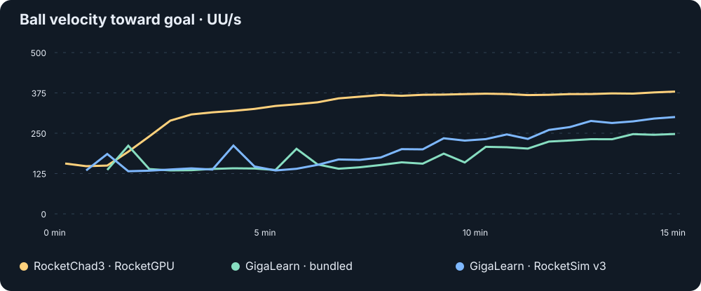

# RocketChad3

GPU self-play training for Rocket League with RocketGPU and PyTorch.

## Setup

1. Use a CUDA GPU, Python 3.10 or newer, and CUDA-enabled PyTorch 2.10 or newer.
2. Build [RocketGPU](https://github.com/thecosmicskye/RocketGPU) with CUDA and Python support. Add its `build/python` directory to `PYTHONPATH` and set `ROCKETGPU_COLLISION_MESH_DIR` as described in its setup instructions.
3. Install RocketChad3 in your virtual environment:

   ```bash
   pip install -e .
   ```

## Train

**One GPU**

```bash
python -m rocketchad --config examples/basic/config.py --out runs/example
```

**Multiple GPUs**

```bash
torchrun --standalone --nproc-per-node=4 -m rocketchad --config examples/basic/config.py --out runs/example
```

Arena and minibatch sizes are per GPU. Set `precision` to `fp32` in the config if your GPU does not support BF16.

The example runs until stopped and saves every ten minutes. To resume, use the same configuration and GPU count, and add `--resume path/to/checkpoint.pt`. Episodes restart through the state setter. The optimizer is recreated when a training phase changes.

## Customize

Copy [examples/basic](examples/basic) into your project and change the pieces you need:

- [Model](examples/basic/model.py): return action logits `[players, actions]` and values `[players]`; select the Muon and critic parameters.
- [Observations](examples/basic/observations.py): return one row per player from the environment.
- [Actions](examples/basic/actions.py): provide a table with one `[throttle, steer, pitch, yaw, roll, jump, boost, handbrake]` row per action.
- [Rewards](examples/basic/rewards.py): return one value per player; the current phase name is passed to the function.
- [Opponents](examples/basic/opponents.py): train against saved policies.
- [State setter and terminal conditions](examples/basic/episode.py): choose starting states, including [replays](examples/basic/replay_starts.py), and when episodes end.
- [Optimizer](examples/basic/optimizer.py): choose `adam`, `adamw` or `muon` in the config, or return your own optimizer.
- [Configuration](examples/basic/config.py) and [Python entry point](examples/basic/run.py): set hyperparameters and pass components to training.

## Benchmark

3v3 · 15-minute target · 3 seeds · RTX 5090 · Xeon Gold 6454S

### 1 GPU · 8 physical CPU cores





### 4 GPUs · 32 physical CPU cores





<details>
<summary>Method and limitations</summary>

- **Training:** Shared 1.23M-parameter model; 8,192 arenas per GPU, 32 decisions and one PPO pass. After 60 seconds of ball-velocity rewards, training used goal/concede rewards, with a critic reset and 16 critic-only updates.
- **Timing:** SPS includes startup and saving.
- **RLGym-Learn:** Advantages normalized per minibatch.
- **GigaLearn:** Four-GPU runs used CPU-staged synchronization after NCCL runs crashed.

</details>

## License

[GNU AGPL v3](LICENSE). The example action table is attributed in [NOTICE](NOTICE).
